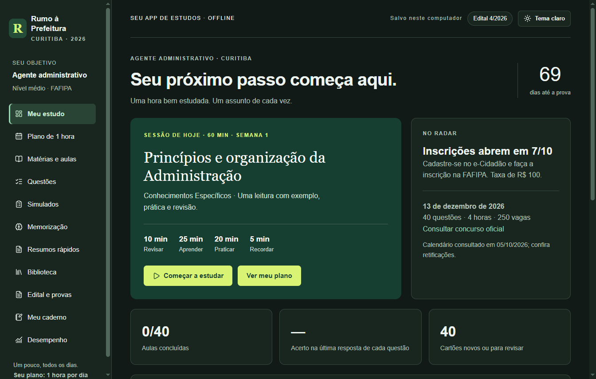
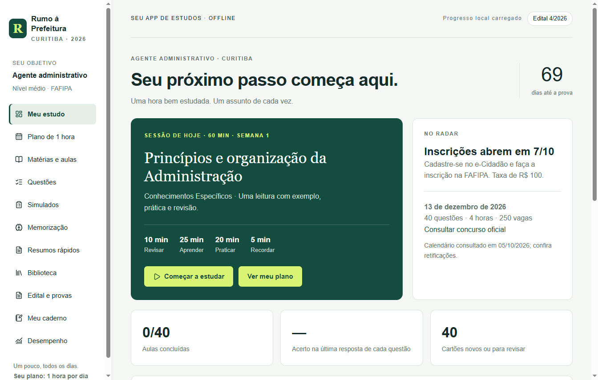

# Plataforma de Estudos

**Rumo à Prefeitura** é um aplicativo de estudos para Windows, com foco em Agente Administrativo da Prefeitura de Curitiba e rotina de **1 hora por dia**. Funciona offline para o conteúdo interno e salva o progresso no próprio computador.



## Recursos

- 40 aulas-guia autorais com fundamentos, exemplos, pegadinhas e perguntas de revisão.
- 80 questões autorais comentadas, filtros por matéria e caderno de erros.
- Simulado completo de 40 questões e minissimulado de 10 questões.
- 40 cartões de revisão espaçada e técnicas de memorização.
- Plano de 10 semanas, cronômetro e registro diário de estudo.
- Resumos para consulta e impressão, caderno pessoal e desempenho por matéria.
- Biblioteca com 21 referências, materiais gratuitos, legislação, edital e provas anteriores.
- Temas claro e escuro, com preferência salva.
- Exportação, backup e restauração do progresso.

As aulas-guia são material de introdução e revisão. As questões do aplicativo são autorais; as provas oficiais anteriores estão identificadas separadamente. Livros, leis, cursos, editais e provas externas abrem no navegador e exigem internet.

<details><summary>Ver tema claro</summary>



</details>

## Executar a partir do código

Requisitos: **Windows 10/11 de 64 bits**, Git e **Node.js 22.13 ou superior**, com npm. A primeira instalação baixa as dependências e o Electron; depois disso o aplicativo não precisa de conexão para estudar o conteúdo interno.

```sh
git clone https://github.com/luizhenriquevfernandes2008-ops/plataforma-de-estudos.git
cd plataforma-de-estudos
npm ci
npm start
```

Se o gerenciador de pacotes bloquear os scripts de instalação do Electron, execute `node node_modules/electron/install.js` antes de `npm start`.

`npm start` compila a interface e abre a janela do aplicativo. A persistência é oferecida pelo processo Electron; abrir apenas o HTML em um navegador não fornece o armazenamento de progresso.

## Compilar o aplicativo Windows

```sh
npm run typecheck
npm test
npm run package:win
```

O resultado fica em `dist/Rumo a Prefeitura-win32-x64/`. Execute `Rumo a Prefeitura.exe` dentro dessa pasta. Para criar um atalho na área de trabalho, use o menu de contexto do executável. Mantenha todos os arquivos da pasta juntos.

O empacotador evita sobrescrever uma compilação anterior. Antes de gerar outra versão, mova a pasta anterior para outro local. O aplicativo gerado não possui assinatura digital de distribuição.

## Uso e armazenamento

1. Em **Meu estudo**, escolha **Começar a estudar**.
2. Divida a sessão em 10 minutos de revisão, 25 de aula, 20 de questões e 5 de anotações.
3. Use **Tema escuro / Tema claro** no topo para alternar a aparência.
4. Clique em **Salvar caderno** após editar suas anotações.
5. Use **Arquivo → Salvar backup** regularmente. **Restaurar backup** permite recuperar uma cópia.

No Windows, os dados ficam em `%APPDATA%/RumoAPrefeitura/progresso.json`. O arquivo `.bak` conserva a gravação anterior. O menu **Arquivo → Pasta do progresso** abre esse local.

O cronômetro e o simulado em andamento não são retomados depois de fechar o app. Conclua e salve o resultado antes de sair. Os resultados salvos, respostas, anotações, revisões, aulas concluídas e preferência de tema permanecem.

O repositório não contém dados pessoais de estudo, perfis de execução, chaves ou credenciais. Não é necessário configurar serviços de nuvem ou variáveis de ambiente para usar o aplicativo.

## Estrutura

```text
src/                 Interface React, aulas, questões e estilos
main.cjs             Janela Electron, protocolo local, menus e backup
store.cjs            Leitura, validação e gravação do progresso
scripts/package.cjs  Empacotamento Windows
tests/               Testes do armazenamento
docs/                Imagens da interface
```

Tecnologias: Electron, React, TypeScript, Vite, Tailwind CSS e Lucide. A janela usa isolamento de contexto e sandbox, sem integração Node.js no conteúdo da interface. Links externos HTTPS abrem no navegador padrão.

## Fontes e atualização do conteúdo

Conteúdo organizado com base na pesquisa de **05/10/2026**, para o **Edital 4/2026**, da Fundação FAFIPA. Datas, requisitos e legislação podem receber alterações; confira as publicações oficiais antes de tomar decisões.

- [Página oficial do concurso na FAFIPA](https://fafipa.selecao.net.br/concurso/4209-concurso-publico-do-municipio-de-curitiba-pr-medio)
- [Edital 4/2026](https://mid-rh.curitiba.pr.gov.br/Arquivo/Concurso/2026/CP%20-%20EDITAL%20NORMATIVO%20N%C2%BA%204.pdf)
- [Conteúdo programático](https://mid-rh.curitiba.pr.gov.br/Arquivo/Concurso/2026/Anexo%20II%20-%20Conte%C3%BAdos%20Program%C3%A1ticos%20-%204_2026.pdf)
- [Prova de Agente Administrativo de 2019 com gabarito, NC/UFPR](https://servicos.nc.ufpr.br/documentos/pmc20192/provas/501.pdf)

A prova de 2019 pertence a outra banca. Legislação e versões de software exigem comparação com o edital atual. As demais referências estão em `src/content.ts` e na biblioteca do aplicativo.

Aplicativo independente, sem vínculo com a Prefeitura ou com a banca. O material e o desempenho nos treinos não garantem aprovação.

## Licenciamento

Este repositório disponibiliza o código para consulta pública, mas ainda não concede uma licença de software livre. Dependências e materiais externos permanecem sujeitos às respectivas licenças e direitos. O valor `private: true` no `package.json` impede publicação acidental no npm; ele não torna este repositório privado no GitHub.
