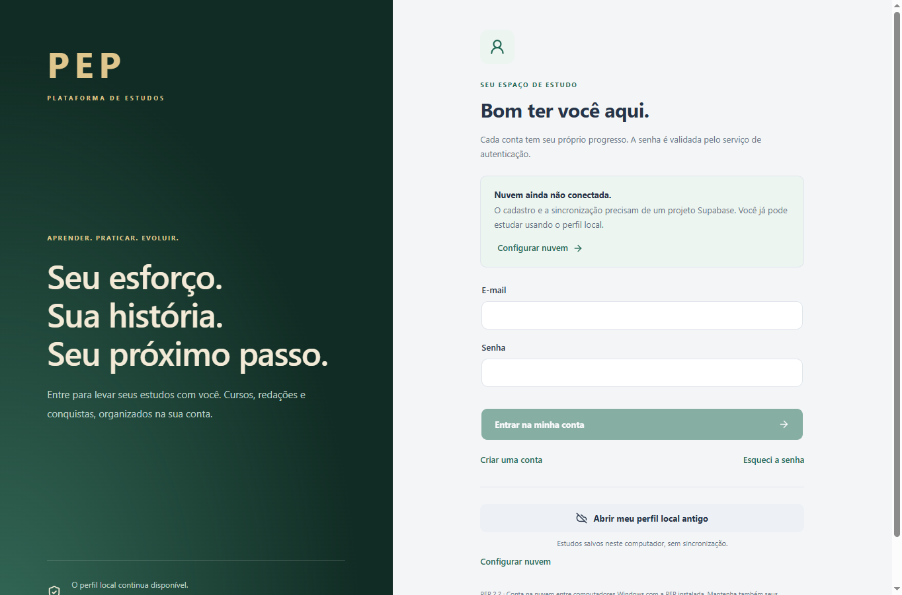
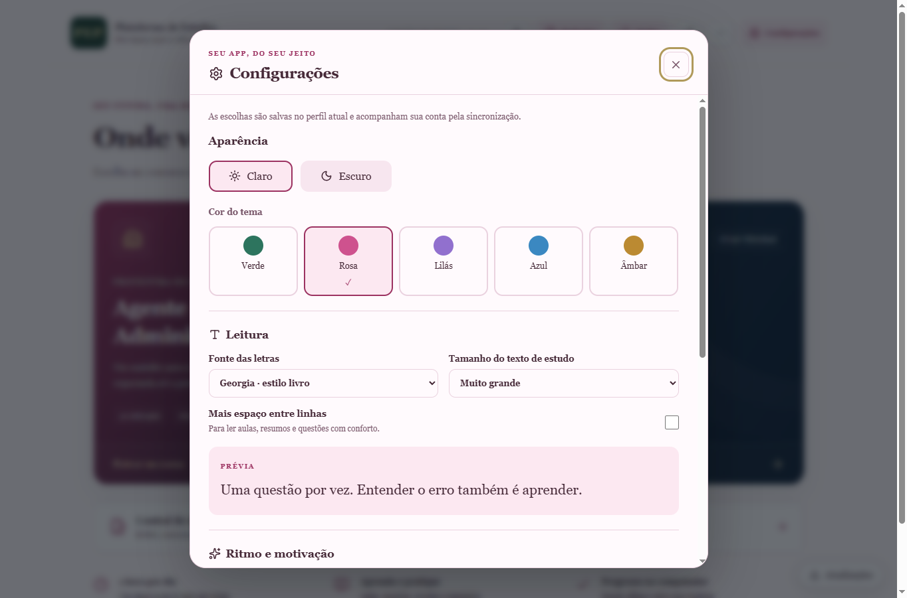
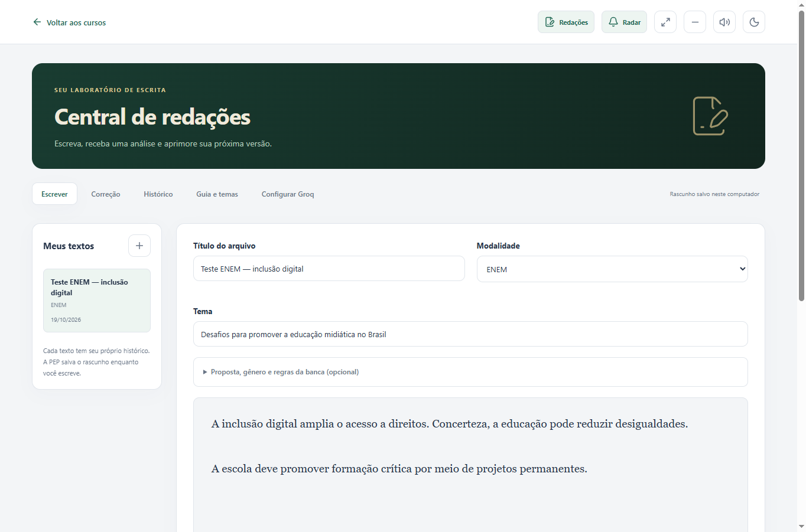

# PEP — Plataforma de Estudos

Aplicativo de estudos para Windows, versão **2.4.0**. Cursos offline, central de redações, radar de concursos e integração de contas com Supabase.



## Cursos

| Trilha | Aulas-guia | Questões autorais |
|---|---:|---:|
| Curitiba — Agente Administrativo | 40 | 160 |
| Banco do Brasil — Agente Comercial | 47 | 100 |
| Banco do Brasil — Agente de Tecnologia | 50 | 102 |

Inclui plano de 1 hora por dia, matérias, questões comentadas, simulados, cartões de memória, resumos, biblioteca de fontes, anotações, temas claro/escuro e abertura PEP com som original.

Curitiba: Edital 4/2026, com link para a versão retificada em 15/10/2026, consultada em 19/10/2026. BB: preparação antecipada baseada no edital histórico 2022/001 e provas de 2023. O app não presume um novo edital ou data de nova prova. Questões são autorais de apoio; provas oficiais e livros externos são links.

## Configurações e motivação

Abra **Configurações** no cabeçalho. Escolha verde, rosa, lilás, azul ou âmbar, em modo claro ou escuro; fonte do sistema, Arial, Verdana, Georgia ou Consolas; três tamanhos de leitura e maior espaço entre linhas. Som da abertura e redução de movimentos também ficam nessa área, com acesso aos avisos do Radar. Preferências pertencem ao perfil e entram no backup e na sincronização.

A opção **Dopamina** liga/desliga XP, níveis, conquistas, missões curtas e celebrações. Desligar esconde esses estímulos sem apagar o progresso nem impedir estudos. XP é calculado a partir das atividades salvas; repetir a mesma questão não soma pontos extras. Não há punição por faltar um dia, ranking de alunos ou recompensa aleatória. A redução de movimentos do Windows é respeitada.



## Estudos próprios e apostila resumida

O primeiro acesso a cada curso neste computador pede um diagnóstico, mesmo para contas existentes. Curitiba, BB Comercial e BB Tecnologia têm avaliações e planos separados. Informe nível por matéria, dificuldades, assuntos e tempo diário; a aba **Estudos próprios** combina essas respostas com aulas pendentes e erros para sugerir prioridades e treinos de dez questões. Você pode revisar o diagnóstico a qualquer momento. O plano é calculado localmente, sem serviço de IA.

Curitiba agora tem **120 questões de Conhecimentos Específicos**, o triplo das 40 anteriores, e 160 no total. As 80 novas incluem justificativa de cada alternativa; todas as questões exibem gabarito e explicação após a correção. A nova aba **Apostila resumida** tem 34 sínteses autorais cobrindo Português, Raciocínio Lógico, Informática, Legislação e Específicos, com exemplos, pontos de atenção e perguntas de revisão. A apostila enviada pelo usuário orientou o roteiro; seu PDF não é redistribuído. Veja [Fontes do material](docs/FONTES-RESUMOS.md).

## Redações, radar e contas

- **Redações:** ENEM, BB, concursos, vestibulares e treino livre; rascunhos com salvamento automático, revisão local, correção com Groq, sugestões reversíveis e histórico por versão.
- **Groq:** chave pessoal protegida pelo Windows. Uso gratuito depende do plano e limites da conta. Nota estimada, sem valor oficial; a revisão local não atribui nota.
- **Radar:** consulta fontes oficiais, detecta novas publicações após uma consulta inicial, organiza etapas e envia lembretes enquanto o app está aberto ou na bandeja. ENEM e autorizações federais são fontes opcionais. Não cobre todos os concursos nem atualiza automaticamente prazos da agenda.
- **Contas:** cadastro, login, confirmação por e-mail, recuperação por código, sessão protegida e progresso separado por usuário. Sincronização com cópia local e tratamento explícito de conflitos.

**A PEP já inclui a conexão pública ao projeto de contas.** Abra o app, escolha **Criar uma conta** e confirme o código recebido por e-mail. Em outro computador Windows, use a mesma versão e conta. O perfil local antigo continua disponível. O arquivo `cloud-defaults.json` contém somente a URL e a chave pública publishable; nenhuma senha ou chave administrativa é distribuída. Uma configuração personalizada existente é preservada. Para administrar ou usar outro projeto, veja [Configurar nuvem](docs/CONFIGURAR-NUVEM.md).



## Usar no Windows

Baixe `PEP-Setup-2.4.0-x64.exe` na página de [releases](https://github.com/luizhenriquevfernandes2008-ops/plataforma-de-estudos/releases/latest) e instale. Quem usa o ZIP antigo precisa instalar esta versão uma vez. Depois, a PEP procura novas versões, baixa em segundo plano e instala ao sair completamente ou pelo botão **Reiniciar e atualizar**. Fechar para a bandeja não encerra o aplicativo. Dados e contas anteriores são preservados. Distribuição Windows x64 sem assinatura digital.

O app inicia em tela cheia. **Esc** sai e **F11** alterna. **Alt** mostra o menu para exportar/importar backup. Consulte o [guia de uso](docs/GUIA-PEP.md).

## Desenvolver e testar

Requisitos: Node.js >=22.13, npm; Windows para gerar o pacote desta distribuição.

```powershell
npm ci
node node_modules/electron/install.js
npm run typecheck
npm test
npm start
```

O comando de instalação do Electron também atende ambientes com scripts do npm desabilitados. Para empacotar:

```powershell
npm run package:win
```

Saída: `dist/installer/PEP-Setup-<versão>-x64.exe`, seu `.blockmap` e `latest.yml`. Publique os três juntos em uma release pública normal, com tag `v<versão>`. Releases em rascunho ou marcadas como prerelease não chegam aos usuários. Veja [Publicar atualizações](docs/ATUALIZACOES.md). O empacotamento usa uma lista explícita de arquivos de runtime e dependências de produção; não inclui perfis, credenciais ou a apostila original.

## Dados e funcionamento

Os dados ficam em `%APPDATA%\PEP-Estudos-2.1`, nome mantido por compatibilidade. O perfil antigo permanece na raiz; contas usam subpastas próprias. A chave Groq e a sessão são protegidas por `safeStorage`/Windows e não entram no backup ou na sincronização. As senhas dos alunos são tratadas pelo Supabase Auth e não são persistidas pela PEP. Os arquivos de progresso locais não são criptografados; a sessão permanece conectada até sair. Use contas Windows separadas se outras pessoas também acessam o computador.

A sincronização envia progresso, textos e correções ao projeto configurado. As políticas RLS do SQL isolam as contas. Mudanças independentes são combinadas; mudanças concorrentes no mesmo registro exigem escolha. Chaves Groq, cache de notícias e opções locais de notificações não são sincronizados. Backups v1–v4 são aceitos; v4 exporta somente o perfil aberto.

O radar exige internet para consultar fontes; os cursos e a revisão por regras funcionam offline. Notificações dependem do Windows e do app em execução. Não há garantia de armazenamento perpétuo, disponibilidade de terceiros, nota oficial ou aprovação.

## Validação e limites da entrega

Testes automatizados cobrem conteúdo, gravação, isolamento, correção estruturada, chaves, limites de API, extração de publicações, sessões e conflitos. A interface foi exercitada no Electron, incluindo backup e navegação. As cinco fontes do radar responderam à consulta de 19/10/2026.

O projeto Supabase real aceitou a chave pública e informou cadastro por e-mail habilitado com confirmação obrigatória; a leitura de progresso sem login foi negada (HTTP 401). O proprietário executou o SQL e configurou SMTP/templates. **Recebimento real de e-mails, isolamento entre duas contas autenticadas e sincronização entre computadores físicos ainda precisam de teste.** As verificações automatizadas de contas usam respostas simuladas; Groq também não foi testado com chave real. Veja [o estado da versão](docs/STATUS.md).

Principais módulos: `main.cjs` (desktop/API local), `essay-service.cjs` (revisão), `radar.cjs` (fontes), `cloud-auth.cjs` (contas), `cloud-sync.cjs` (sincronização), `src/account-ui.tsx`, `src/writing-studio.tsx`, `src/radar-view.tsx` e `src/course-room.tsx`. Os arquivos antigos de interface foram preservados como referência.
